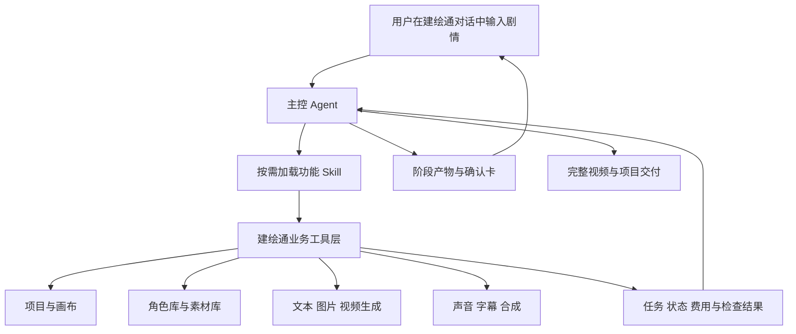
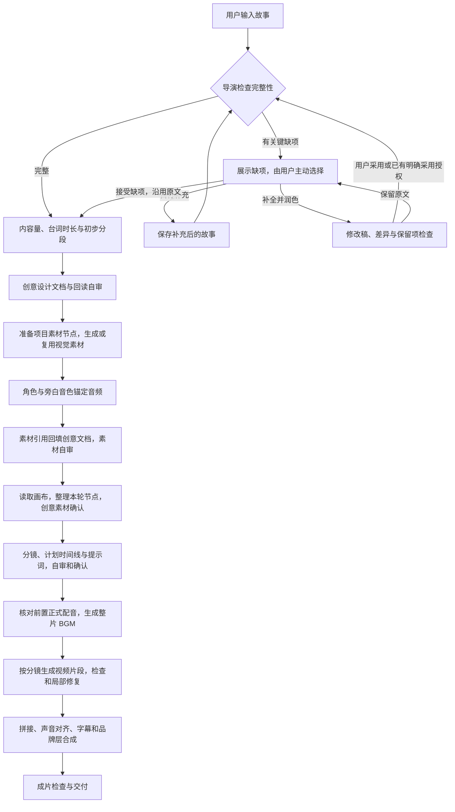

# 建绘通 · 对话式视频创作 Agent

> 版本：0.3.0。已实现建绘通对话页、主控运行引擎、16 个功能 Skill 的按需加载与业务绑定，以及从故事到本地 MP4 合成的完整流程。工具目录逐项标明当前能力与限制。

本 Agent 属于建绘通产品内部。用户在建绘通的项目对话中输入剧情，Agent 理解需求、制定方案，并通过建绘通提供的业务工具操作项目、画布、脚本、角色库、素材库和生成任务，最终完成配音、音乐、字幕与视频合成。

本目录采用项目自有的声明式格式。`AGENT.md` 是主控指令，`SKILL.md` 是功能模块指令，`agent.yaml` 是模块注册表；它们由建绘通的 `agent_runtime.py` 加载，不依赖外部编程助手、桌面应用或个人技能目录。

本版按已确认流程优化：先由导演检查故事，缺项时由用户主动决定是否补全润色；素材通过项目节点准备，图片与音色就绪后回填创意文档；分镜确认后先制作整片 BGM，再生成视频片段并合成。

## 建议审阅顺序

1. [AGENT.md](AGENT.md)：主控身份、对话行为、调度决策和完成标准。
2. 下方的子 Skill 表：逐项检查每个功能应该怎么工作。
3. [对话协议](contracts/conversation.md)：确认卡、用户修改、进度与最终交付。
4. [工具目录](contracts/tools.yaml)和[运行契约](contracts/runtime.md)：Agent 如何调用建绘通功能。
5. [故事处理分支](examples/story-decisions.md)与[运行快照结构](examples/run-snapshot.json)：检查选择、草稿采用和恢复状态。
6. [审阅清单](REVIEW.md)：集中记录需要修改的产品决策。

## 系统组成



主控负责判断下一步、管理确认和解释结果。子 Skill 负责一个明确功能，返回结构化结果。工具负责真实读写、提交任务、保存文件和返回状态。一个 Skill 不等于一个独立运行的子 Agent；首版由主控按需加载各模块，本版业务任务按依赖顺序执行。

## 子 Skill 注册表

| Skill | 职责 | 对应建绘通能力 |
| --- | --- | --- |
| [project-context](skills/project-context/SKILL.md) | 识别项目、恢复上下文、确定本次范围 | 项目管理、模板、历史任务 |
| [director](skills/director/SKILL.md) | 检查故事完整性，把关创意、分镜和成片表达 | 故事评估、用户选择、审阅文档 |
| [story-polishing](skills/story-polishing/SKILL.md) | 用户主动选择后润色或补全，保留原稿与差异 | 专用故事润色、草稿采用 |
| [model-budget](skills/model-budget/SKILL.md) | 选择模型、检查输入能力和费用范围 | 模型管理、能力与额度查询 |
| [story-analysis](skills/story-analysis/SKILL.md) | 导演检查后分析内容量、台词时长和初步分段 | 对话推理、文本和脚本资产 |
| [creative-design](skills/creative-design/SKILL.md) | 撰写创意、自审，素材就绪后回填引用 | 创意文档、文本资产 |
| [visual-assets](skills/visual-assets/SKILL.md) | 通过素材节点复用或生成视觉参考 | 图片生成、素材库、角色库 |
| [storyboard-planning](skills/storyboard-planning/SKILL.md) | 编排镜头、动作、台词和素材 | 脚本生成、分镜编辑 |
| [prompt-composition](skills/prompt-composition/SKILL.md) | 生成可提交的视频提示词 | 脚本提示词合成 |
| [video-generation](skills/video-generation/SKILL.md) | 批量提交、查询、保存片段 | 视频生成、任务管理、视频入库 |
| [voice-production](skills/voice-production/SKILL.md) | 角色音色锚定、正式对白和旁白制作 | 现有音频服务、声音参考与正式配音 |
| [music-production](skills/music-production/SKILL.md) | 视频前制作整片 BGM，后期适配实际时长 | 现有音频服务、整片音乐与节拍表 |
| [video-editing](skills/video-editing/SKILL.md) | 时间线、混音、字幕、片尾与导出 | 本地 FFmpeg、字幕混音与 MP4 入库 |
| [quality-review](skills/quality-review/SKILL.md) | 文档、素材、片段和成片检查 | 文件、时长、尺寸与人工内容检查 |
| [canvas-management](skills/canvas-management/SKILL.md) | 节点、素材绑定、镜头展开与分组 | 画布和脚本资源图 |
| [revision-recovery](skills/revision-recovery/SKILL.md) | 修改影响分析、断点恢复与取消 | 历史任务、版本和运行状态 |

## 默认创作流程



执行阶段为 `intake → story_review → analysis → creative → assets → storyboard → music → video → postproduction → review → delivery`，共 11 个阶段。流程图展开了各阶段中的关键动作，具体退出条件见[工作流](contracts/workflow.yaml)。

完整故事直接继续，开放式结尾按创作意图判断。有缺项时才展示 S0 故事处理选择，不自动改写；润色稿被采用前不进入时长分析。用户接受缺项继续时保留取舍，不反复要求补全。

素材节点先建立或复用，再关联生成任务和真实结果。创意文档回填资产 ID、节点 ID、声音 ID 及受保护路径；回读检查完成后整理画布。分镜使用这份已回填且采用的版本。节点存在、任务受理、素材已生成是不同状态。

音色锚定是可试听的声音参考，正式配音是最终使用的具体台词。需要前置配音时先实测并解决时长冲突，再根据分镜的 `PlannedTimeline` 生成 BGM；此时无需实际视频文件。片段生成后以实际 `Timeline` 裁切、循环或淡入淡出已有音乐，只有无法适配才考虑重制。

默认保留 G1 参数与初始范围、G2 创意素材、G3 分镜与生成策略三个制作审阅节点，成片后增加 G4 观看检查。已有成果可续作；只要分镜时跳过媒体生成；无配乐时跳过音乐制作。首版暂不提供独立样片批次选择。具体规则见[对话协议](contracts/conversation.md)。

## 使用和实际调用

启动建绘通并登录后，首页默认进入「Agent 创作」。先在模型管理配置文本、图片、视频、音频服务，随后输入故事。页面支持引用/上传素材、创作记录、模型偏好、分步确认、文档查看下载、音视频预览和嵌入项目画布。G3 确认后先配音和 BGM，再生成片段与合成。

主控通过现有 Python 业务函数调用项目、图片、音频、视频和素材服务；本次增加了会话 API、持久化操作日志、画布展开及本地视频合成。它不依赖外部编程助手。`jht_*` 是工具逻辑名称，不是额外的 33 个公开 API。实际绑定见[工具目录](contracts/tools.yaml)，请求与部署说明见[运行说明](contracts/runtime.md)。

| 入口 | 实现 |
| --- | --- |
| 对话 UI | `public/agent-chat.js`、`public/agent-chat.css` |
| 主控与会话 API | `agent_runtime.py`，前缀 `/api/agent` |
| 图像、音频、视频、角色及资产 | 复用 `app.py` 的业务服务和模型适配器 |
| 画布 | 主控服务端按节点合并，现有前端实时展示与编辑 |
| 视频合成 | `agent_media.py` + imageio-ffmpeg |
| 验证 | `tests/test_agent_runtime.py`、`tests/verify_agent_ui.py` |

默认引导式流程需确认参数、创意素材、分镜及最终观看结果。局部镜头和片尾修改复用有效产物，失败须主动重试，重启后先核对任务回执。费用查询、自动口型同步、逐字字幕对齐和自动画面审查尚不可用，不能将这些能力显示为已完成。

Agent 画布按七个制作阶段分区排列，带箭头的实线表示生成输入，虚线表示文档、素材、音色、镜头和成片之间的流程关联。画布上方可定位阶段或点击“整理画布”。`agent_canvas.py` 负责确定性布局和关系同步；旧网格项目在打开时自动迁移，保留手动移动的节点、手动连接及所有素材引用。主动整理接口为 `POST /api/agent/runs/{rid}/canvas/layout`，仅当前对话所有者可调用，不提交生成任务。

对话中的“查看文件”使用本地 Marked 与 DOMPurify 渲染 Markdown，包括标题、列表、表格、引用、链接和代码块；结构化 JSON 文档以代码块呈现，原始 `.md` 下载不变。模型文本经标签及属性白名单清洗后插入页面。

## 文件职责

| 文件或目录 | 用途 |
| --- | --- |
| [agent.yaml](agent.yaml) | 主控入口、共享契约、16 个 Skill 及各自工具范围 |
| [AGENT.md](AGENT.md) | 可交给建绘通主控模型的行为指令 |
| `skills/` | 各功能的输入、执行步骤、工具与返回要求 |
| [contracts/workflow.yaml](contracts/workflow.yaml) | 阶段依赖、确认节点及进入交付的条件 |
| [contracts/tools.yaml](contracts/tools.yaml) | 工具输入、返回对象、业务映射和接入限制 |
| [contracts/runtime.md](contracts/runtime.md) | 调用信封、事件、幂等、版本、错误与恢复 |
| [contracts/artifacts.md](contracts/artifacts.md) | 运行状态和各类产物的数据约定 |
| [contracts/conversation.md](contracts/conversation.md) | 对话卡片、澄清、确认、修改和交付 |
| `templates/` | 故事检查、时长分析、创意、分镜、提示词与配乐产物模板 |
| `examples/` | 通用流程分支和结构化示例，不包含具体项目故事 |
| [REVIEW.md](REVIEW.md) | 审阅问题与行为验收场景 |

## 验证与审阅

后端测试使用独立数据库和模拟供应商响应，合成部分实际执行 FFmpeg 并验证导出的媒体。浏览器验证使用独立服务与测试账号，覆盖首屏、分页确认、素材、画布、交付、刷新恢复和窄屏布局；不会修改日常项目数据。

```powershell
.\.venv\Scripts\python.exe -m unittest discover -s tests -p "test_*.py"
node --check public/agent-chat.js
node tests/agent_canvas_inputs.test.mjs
# 可选：需要 Playwright 和已安装的 Chrome
.\.venv\Scripts\python.exe tests/verify_agent_ui.py
```

上述测试不等于真实模型成片质量验证。实际生成需要部署方配置可用服务及密钥，人物连续性、台词听感和字幕时机由最后的观看确认检查。

后续修改以本目录及实际运行代码为准。[旧入口](../../docs/video-generation-agent/README.md)指向本包；启动方法见[项目 README](../../README.md)。
